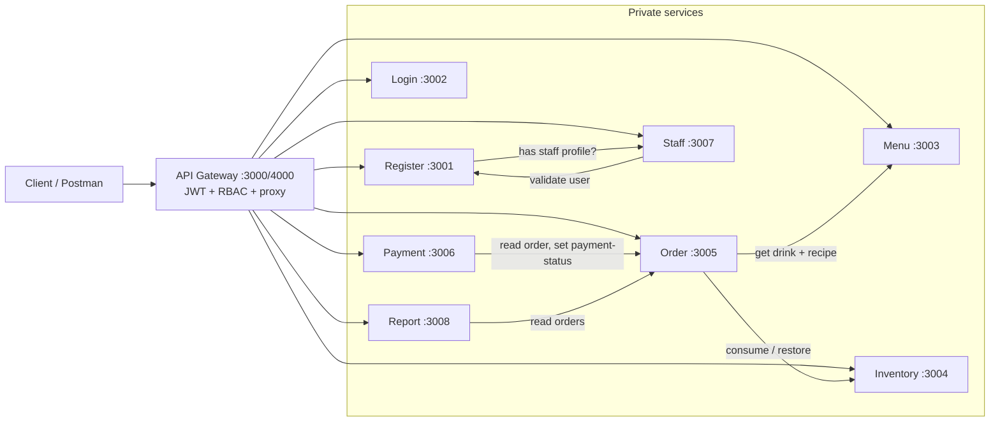

# Coffee Management Platform Architecture

## 1. Overview

A backend-only coffee shop management platform made of **9 independent Node.js/Express microservices**. A shop can manage its menu, stock, orders, payments, staff shifts, and sales reports. Access is role-based, enforced at the API Gateway with JWTs. Everything is tested through Postman (`CoffeeManagement_All_Microservices.postman_collection.json`). Docker and load-balancer work (Phase 10) has **not been started**; there are no Dockerfiles yet.

### Roles

| Role | Can do |
| --- | --- |
| `admin` | Full control: menu, inventory, staff and shifts, payment history, reports, creating staff accounts, creating orders |
| `barista` | Views menu and stock, updates order status, records counter payments, reads own staff profile and shifts |
| `customer` | Browses the menu, places and views their own orders, pays for their own orders |

## 2. System map



Solid arrows from the Gateway are public routes. Arrows between services are **internal HTTP calls** authenticated with `x-internal-key`; the Gateway never exposes them.

## 3. Services

| Service | Port | Database | Responsibility |
| --- | --- | --- | --- |
| `api-gateway` | 3000 (`.env.example` sets 4000) | none | Only public entry point. Verifies JWT, enforces roles, proxies |
| `register` | 3001 | `users` (Atlas, `Coffee`) | Owns user accounts. Public registration (always `customer`), admin-created `admin`/`barista`, list/get/delete users. `seed-admin.js` creates the first admin |
| `login` | 3002 | `users` (shared with register) | Checks email/password with bcrypt, signs the JWT. Runs from `authentication.js` |
| `menu` | 3003 | own DB | Drinks, prices, availability and **recipes** (`[{stockItemId, qty}]`). Owns drinks |
| `inventory` | 3004 | own DB | Stock items and quantities. Owns stock. Internal `consume`/`restore` |
| `order` | 3005 | `order_db` | Creates orders, status flow, ownership filtering. Can run as several instances |
| `payment` | 3006 | own DB | Payments, duplicate protection, tells Order an order is paid |
| `staff` | 3007 | own DB | Barista employment profile (by `userId`) and shifts |
| `report` | 3008 | **none** | Daily and top-drinks reports computed from Order's data |

Each service is its own package (`package.json`, `node_modules`, `.env`). There is no root package. Run with `cd <service> && npm start`; `register`, `report`, and `staff` also have `npm test` (`node --test test.js`).

**Data ownership rules:** a service only writes its own database. Menu never uses Mongoose population across databases; it stores `stockItemId` as a plain ObjectId. Report never connects to the order database; it asks Order over HTTP. Staff stores only the barista's `userId`, while Register owns the account.

## 4. Gateway route map and roles

The Gateway has an **explicit allowlist**; anything else returns `404 Route not found`. A new service endpoint is unreachable until a route is added in `api-gateway/gateway.js`, before the catch-all.

| Route | Roles | Service |
| --- | --- | --- |
| `GET /`, `GET /health` | public | Gateway |
| `POST /register` | public | Register |
| `POST /auth/login` | public (rewritten to `/login`) | Login |
| `/admin/users`, `/admin/users/:id` (GET, POST, DELETE) | admin (`/admin` prefix is stripped) | Register |
| `GET /menu`, `GET /menu/:id` | any authenticated | Menu |
| `POST /menu`, `PUT /menu/:id`, `DELETE /menu/:id` | admin | Menu |
| `GET /inventory`, `GET /inventory/low` | admin, barista | Inventory |
| `POST /inventory`, `PUT/DELETE /inventory/:id` | admin | Inventory |
| `POST /orders` | admin, customer | Order |
| `GET /orders`, `GET /orders/:id` | any authenticated (Order filters customers to their own) | Order |
| `PUT /orders/:id/status` | admin, barista | Order |
| `POST /payments` | customer, barista | Payment |
| `GET /payments/:orderId` | any authenticated (customers: own only) | Payment |
| `GET /payments` | admin | Payment |
| `GET /staff/me`, `GET /staff/me/shifts` | barista | Staff |
| `POST/GET /staff`, `DELETE /staff/:id`, `POST/GET /shifts`, `DELETE /shifts/:id` | admin | Staff |
| `GET /reports/daily`, `GET /reports/top-drinks` | admin | Report |

**Deliberately not mounted** (internal only): `/inventory/consume`, `/inventory/restore`, `/orders/:id/payment-status`, `/internal/*`.

## 5. Authentication and trust boundaries

1. **Login** verifies credentials and signs an HS256 JWT containing `userId`, `name`, `email`, `role`. The role comes from the database, never from the request. Lifetime is `JWT_EXPIRES_IN` (default `1h`).
2. **Gateway** verifies signature, expiry, and claim shapes, then checks the role for the route.
3. Before proxying, the Gateway **deletes any client-supplied `x-user-*` / `x-auth-*` headers** and sets `x-user-id`, `x-user-name`, `x-user-email`, `x-user-role` from the verified token.
4. **Downstream services trust these headers** and do their own role checks. They do not verify JWTs.
5. **Service-to-service calls** carry `x-internal-key` (`INTERNAL_API_KEY`, identical in every service that uses it) plus forwarded identity headers.

Because downstream services trust headers, **they must not be reachable by clients directly**. If a client could call port 3005, it could forge `x-user-role: admin`. In deployment, only the Gateway may reach the service ports.

`JWT_SECRETE` is intentionally spelled that way and must be identical in the Gateway and Login.

## 6. Key flows

### 6.1 Order creation (Order → Menu → Inventory)

```text
Customer/admin POST /orders  (via Gateway)
  → for each item: GET Menu /menu/:id         reject missing/unavailable drinks
  → use Menu prices (client prices are ignored)
  → combine recipe quantities across items
  → POST Inventory /inventory/consume          fails 409 if stock is short
  → save order in order_db                     (paymentStatus unpaid, status pending)
  → if saving fails: POST Inventory /inventory/restore   (compensation)
```

Status can only move `pending → preparing → ready → completed`, and a completed order must already be paid. Only Payment can change `paymentStatus`. Every Order response carries `X-Served-By: <INSTANCE_ID>` (default `order-A`), so the same code can run twice with different `PORT` and `INSTANCE_ID` for load balancing.

### 6.2 Payment (Payment → Order)

```text
POST /payments (customer for own order, or barista at counter)
  → GET Order /orders/:id                      order exists and is unpaid
  → verify customer ownership and exact amount (wrong amount: 400, duplicate: 409)
  → create payment
  → PUT Order /orders/:id/payment-status        internal route, failure-safe
```

Admins cannot create payments.

### 6.3 Reports

Report has no database. It calls Order internally, counts only paid orders, validates `YYYY-MM-DD` filters, and computes order count, total revenue, average order value, and quantity and revenue per drink.

### 6.4 Staff and users

An admin creates a barista account through `POST /admin/users` (Register), then creates the staff profile through `POST /staff` (one profile per barista `userId`). Staff checks the user with Register's internal `/internal/users/:id`. Register refuses to delete a barista who still has a staff profile, asking Staff over `/internal/staff/by-user/:id`. Shifts validate dates and `HH:mm` times, require `startTime < endTime`, and reject overlaps; they can be filtered by `date` and `staffId`.

### 6.5 Bootstrapping the first admin

Public registration always yields `customer`. Run `npm run seed:admin` in `register` (needs `ADMIN_NAME`, `ADMIN_EMAIL`, `ADMIN_PASSWORD`) to insert the first admin directly in MongoDB. It skips if the email exists.

## 7. Configuration

Each service reads its own `.env` (git-ignored; most have a `.env.example`).

```text
Gateway.JWT_SECRETE = Login.JWT_SECRETE
Gateway.*_SERVICE_URL   -> the 8 service base URLs (all required at startup)
INTERNAL_API_KEY        -> same value in inventory, order, payment, register, report, staff
Order.MENU_SERVICE_URL, INVENTORY_SERVICE_URL
Payment.ORDER_SERVICE_URL          Report.ORDER_SERVICE_URL
Staff.REGISTRATION_SERVICE_URL     Register.STAFF_SERVICE_URL
Order.INSTANCE_ID       -> value of X-Served-By
SERVICE_REQUEST_TIMEOUT_MS (default 5000) for internal HTTP calls
```

Data services use `URI` (MongoDB connection string); Register and Login build the Atlas connection from `db_password` instead. Services connect to MongoDB before they open their HTTP port. Mismatched secrets cause `401 Invalid token` everywhere, wrong URLs cause `502 Microservice is unavailable`, and a wrong `INTERNAL_API_KEY` causes `401` on internal calls.

## 8. Error conventions

`400` invalid input · `401` bad credentials, missing/invalid/expired token, or bad internal key · `403` wrong role · `404` unknown route or resource · `409` conflict (duplicate email, duplicate payment, insufficient stock) · `502` a downstream service is unreachable or returned something unusable. Internal `serviceClient.js` helpers pass through only 400/403/404/409 from dependencies and map everything else to 502.

## 9. Project status

| Phase | Status |
| --- | --- |
| Gateway, Register, Login | Done |
| Menu (with recipes), Inventory | Done |
| Order, Payment | Done |
| Staff/Shift, Report | Done (services and gateway routes present) |
| Gateway routes for all services | Done |
| Postman collection | Present; re-run it end to end against all services |
| **Phase 10: Docker, Nginx, deployment** | **Not started** |

## 10. Planned deployment (Phase 10)

Target: one container per service, on separate EC2 instances, with Order running twice (`order-A` on 3005, `order-B` on 3015) behind Nginx. Not yet implemented:

- a Dockerfile per service using `npm ci --omit=dev` (needs `package.json` and `package-lock.json` in sync), plus `.dockerignore`;
- Docker Compose for local runs, including Order A and B;
- Nginx upstream configuration for Order, and `ORDER_SERVICE_URL` pointing at it;
- `.env.example` for every service and deployment notes;
- network rules so only the Gateway (and Nginx) can reach service ports.
