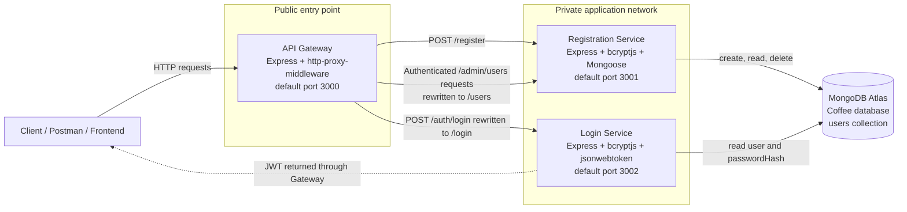
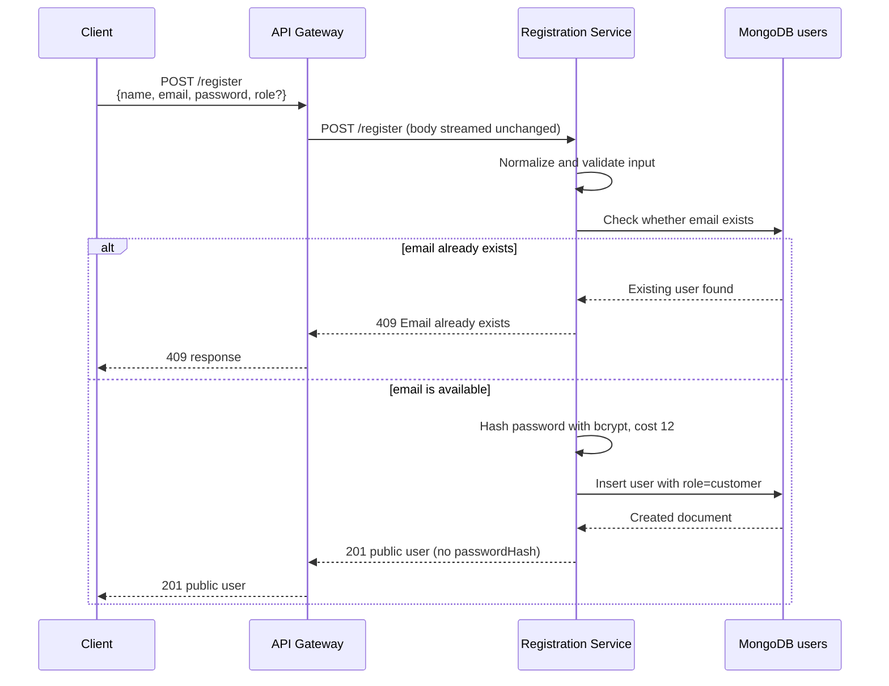
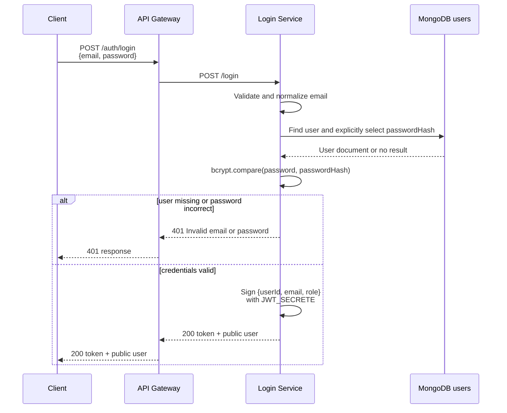
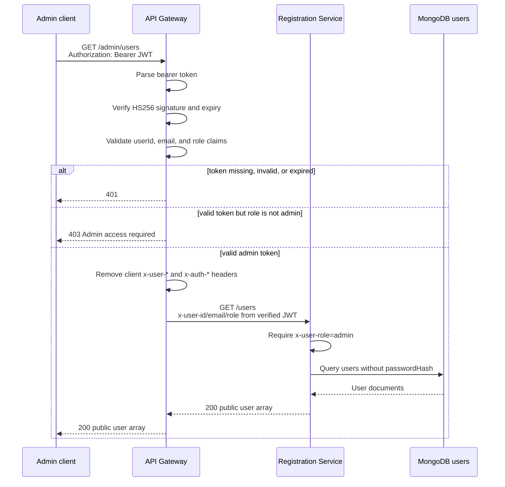

# Coffee Management Application Architecture

## 1. Purpose and current scope

This repository currently implements the identity and user-management part of a Coffee Management application. It uses three independent Node.js processes:

1. **API Gateway** — the public entry point. It routes requests, verifies JSON Web Tokens (JWTs), and enforces administrator access.
2. **Registration Service** — creates customer, administrator, and barista accounts and owns user-management operations.
3. **Login Service** — verifies credentials and issues JWTs.

The Registration and Login services use the same MongoDB Atlas database and the same `users` collection. There are not yet separate menu, order, inventory, payment, or reporting services in this repository.

## 2. High-level architecture



In local development, the Postman collection expects the Gateway at `http://localhost:4000`, Registration at `http://localhost:3001`, and Login at `http://localhost:3002`. The Gateway source has a default port of `3000`, so its `.env` must set `PORT=4000` to match the collection.

## 3. Component responsibilities

### 3.1 Client

The client can be Postman, a browser frontend, a mobile application, or another approved consumer. It should call the API Gateway for application operations.

The client is responsible for:

- sending JSON request bodies with `Content-Type: application/json`;
- storing the JWT returned after login;
- sending protected requests with `Authorization: Bearer <token>`;
- never treating a client-supplied role or identity header as proof of identity.

The supplied Postman collection calls service health endpoints directly for diagnostics. That is useful during local development, but normal application traffic should enter through the Gateway.

### 3.2 API Gateway (`api-gateway/gateway.js`)

The Gateway is the boundary between public clients and internal services. It does not connect to MongoDB and does not create users itself. Its responsibilities are:

- expose the public API;
- forward registration and login requests to the correct service;
- validate bearer tokens for protected routes;
- require the `admin` role for all `/admin` routes;
- remove any client-supplied `x-user-*` or `x-auth-*` headers;
- add trusted identity headers after verifying the JWT;
- translate a downstream connection failure into `502 Microservice is unavailable`;
- return `404 Route not found` for any route not explicitly exposed.

The Gateway requires these environment variables:

| Variable | Purpose |
| --- | --- |
| `PORT` | Public Gateway port; defaults to `3000` |
| `JWT_SECRETE` | Shared secret used to verify HS256 JWTs |
| `REGISTRATION_SERVICE_URL` | Base URL of the Registration service |
| `LOGIN_SERVICE_URL` | Base URL of the Login service |

The project intentionally uses the name `JWT_SECRETE`. The Login service and Gateway must use exactly the same variable name and secret value.

### 3.3 Registration Service (`register/index.js`)

The Registration service owns all writes to user accounts. It:

- validates names, email addresses, and passwords;
- normalizes email addresses by trimming them and converting them to lowercase;
- hashes passwords with bcrypt using 12 salt rounds;
- creates public registrations only as `customer`;
- lets an authenticated administrator create `admin` or `barista` accounts;
- lists users, retrieves a user by ID, and deletes a user;
- never returns `passwordHash` in API responses;
- handles duplicate emails with HTTP `409`.

Its default port is `3001`. It requires `db_password` to construct the MongoDB Atlas connection string. The one-time seed script additionally requires `ADMIN_NAME`, `ADMIN_EMAIL`, and `ADMIN_PASSWORD`.

### 3.4 Login Service (`login/index.js`)

The Login service authenticates existing accounts. It does not create or modify users. It:

- validates that an email and password were supplied;
- normalizes the email address;
- loads the user from the shared `users` collection;
- explicitly selects `passwordHash`, which is hidden by default in the schema;
- compares the submitted password with the bcrypt hash;
- reads the user's role from MongoDB, never from the request body;
- signs and returns a JWT after successful authentication.

Its default port is `3002`. It requires `db_password` and `JWT_SECRETE`; `JWT_EXPIRES_IN` is optional and defaults to `1h`.

`login/authentication.js` is an older alternate implementation and is not started by `npm start`. The active entry point is `login/index.js` as declared in `login/package.json`.

### 3.5 MongoDB Atlas

Both data services connect to:

- database: `Coffee`;
- collection: `users`;
- model: `User`.

The shared document structure is:

| Field | Rules |
| --- | --- |
| `_id` | MongoDB ObjectId generated by MongoDB |
| `name` | Required trimmed string |
| `email` | Required, unique, lowercase, and trimmed |
| `passwordHash` | Required bcrypt hash; excluded from normal queries with `select: false` |
| `role` | Required enum: `admin`, `barista`, or `customer`; default `customer` |
| `phone` | Optional trimmed string |
| `createdAt`, `updatedAt` | Automatically managed by Mongoose timestamps |

The duplicated `userModel.js` files in Registration and Login must remain structurally compatible because they represent the same MongoDB collection.

## 4. Public route map

| Client request to Gateway | Authentication | Downstream request | Owner |
| --- | --- | --- | --- |
| `GET /` | None | None | Gateway |
| `GET /health` | None | None | Gateway |
| `POST /register` | None | `POST /register` | Registration |
| `POST /auth/login` | None | `POST /login` | Login |
| `GET /admin/users` | Valid admin JWT | `GET /users` | Registration |
| `POST /admin/users` | Valid admin JWT | `POST /users` | Registration |
| `GET /admin/users/:id` | Valid admin JWT | `GET /users/:id` | Registration |
| `DELETE /admin/users/:id` | Valid admin JWT | `DELETE /users/:id` | Registration |

The `/admin` prefix is removed when the Gateway router forwards the request. For example, the client-facing `/admin/users/123` becomes `/users/123` inside the Registration service.

Registration and Login also implement their own `GET /health` endpoints. These are internal health checks and are not proxied by the Gateway.

## 5. End-to-end request flows

### 5.1 Customer registration



Important security behavior: even if the request contains `"role": "admin"`, the Registration service overrides it with `customer`. Public registration therefore cannot be used to self-assign an elevated role.

### 5.2 Login and JWT creation



The token contains `userId`, `email`, and `role`. Its lifetime comes from `JWT_EXPIRES_IN`, with a default of one hour. The Login service signs the token and the Gateway verifies it, so both processes must share the same `JWT_SECRETE` value.

### 5.3 Protected administrator request



The same authorization sequence protects administrator create, get-by-ID, and delete operations.

### 5.4 Initial administrator creation

There is a bootstrap problem: an administrator is required to create elevated users, but a public user cannot register as an administrator. `register/seed-admin.js` solves this once during setup:

1. Read `ADMIN_NAME`, `ADMIN_EMAIL`, and `ADMIN_PASSWORD` from the Registration service environment.
2. Connect directly to MongoDB.
3. Normalize the email and check whether it already exists.
4. Hash the password with bcrypt.
5. Insert the first user with `role: "admin"`.
6. Disconnect from MongoDB.

Run it from `register` with `npm run seed:admin`. It is a one-time command, not another long-running microservice. If the email already exists, it safely skips creation.

## 6. Authentication, authorization, and trust boundaries

Authentication answers **who is making the request**. Authorization answers **what that authenticated user may do**.

- The Login service authenticates email/password and creates a signed JWT.
- The Gateway authenticates later requests by verifying that JWT.
- The Gateway authorizes `/admin` routes by requiring `role === "admin"`.
- The Registration service performs a second admin check using the trusted `x-user-role` header inserted by the Gateway.

The internal identity headers are:

- `x-user-id`;
- `x-user-email`;
- `x-user-role`.

Before proxying, the Gateway deletes any `x-user-*` and `x-auth-*` headers supplied by the client. It then reconstructs the identity headers from verified token claims. This prevents a client from simply sending `x-user-role: admin` through the Gateway.

However, the Registration service itself only checks the header; it does not verify the JWT. Therefore, the Registration service must not be publicly reachable in production. Network rules should allow user-management traffic to reach it only from the Gateway. If a client can call port `3001` directly, it can forge `x-user-role: admin` and bypass Gateway authorization.

## 7. Error propagation

Errors are returned through the same service chain that handled the request:

- `400 Bad Request` — invalid input, malformed JSON in Registration, or an unsupported admin-created role;
- `401 Unauthorized` — invalid login credentials, missing bearer token, invalid token claims/signature, or expired token;
- `403 Forbidden` — authenticated non-admin accessing an admin route, or missing trusted admin header at Registration;
- `404 Not Found` — unknown Gateway/service route or user ID not found;
- `409 Conflict` — duplicate email;
- `500 Internal Server Error` — unexpected service/database failure;
- `502 Bad Gateway` — Gateway cannot connect to a downstream microservice.

For proxy failures, the Gateway hides internal connection details from the client and logs the lower-level error code on the server.

## 8. Process startup and dependencies

Each folder is an independent Node.js package and should install and run its own dependencies.

| Process | Start command | Startup behavior |
| --- | --- | --- |
| Registration | `cd register && npm start` | Loads environment, connects/pings MongoDB, then starts HTTP listener |
| Login | `cd login && npm start` | Checks JWT secret, connects/pings MongoDB, then starts HTTP listener |
| Gateway | `cd api-gateway && npm start` | Validates required environment variables, then starts HTTP listener |

A practical local startup order is MongoDB availability first, then Registration and Login, and finally the Gateway. The Gateway can technically start before the services, but requests to an unavailable service will return `502`.

The data services deliberately connect to MongoDB before opening their HTTP ports. This avoids reporting the process as available while its required database is unavailable.

## 9. Configuration relationships

```text
Gateway.JWT_SECRETE = Login.JWT_SECRETE
Gateway.REGISTRATION_SERVICE_URL -> Registration host and port
Gateway.LOGIN_SERVICE_URL        -> Login host and port
Registration.db_password         -> MongoDB Atlas credential
Login.db_password                -> MongoDB Atlas credential
Registration database/collection = Login database/collection = Coffee.users
```

Changing one side without its matching configuration causes predictable failures:

- different JWT secrets cause every protected request to return `401 Invalid token`;
- an incorrect service URL causes the Gateway to return `502`;
- different database targets can allow registration to succeed but make the new account invisible to Login;
- incompatible user schemas can prevent password verification or role loading.

## 10. Architectural constraints and future extension

When adding a new microservice, preserve the current boundary:

1. Give the service one clear business responsibility and its own process/port.
2. Add an internal service URL to the Gateway configuration.
3. Expose only required client routes at the Gateway.
4. Verify JWTs and roles at the Gateway before proxying protected traffic.
5. Strip untrusted identity headers and forward identity derived from the verified token.
6. Keep the new service private so clients cannot bypass Gateway controls.
7. Decide explicit data ownership instead of allowing every service to modify every collection.
8. Add health checks and end-to-end tests for both successful and rejected flows.

For example, a future Order service could accept a protected `POST /orders` through the Gateway. The Gateway would verify the user, send the trusted user ID to the private Order service, and the Order service would store an order owned by that ID. It should not accept an arbitrary customer ID from the request body as proof of ownership.

## 11. Current verification boundary

This document describes the architecture implemented by the current source files and Postman collection. Static code inspection confirms the route mappings, schema, hashing behavior, JWT claims, authorization middleware, and environment-variable relationships. Actual availability still depends on valid local `.env` values, network access to MongoDB Atlas, and all three processes running. A successful syntax check alone is not proof of a working database-backed end-to-end flow.
